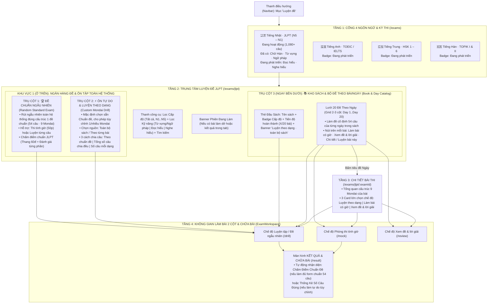
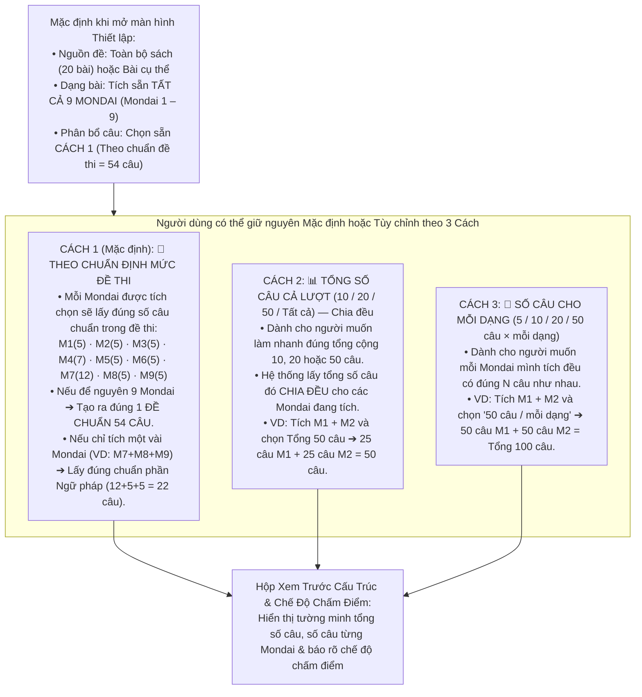
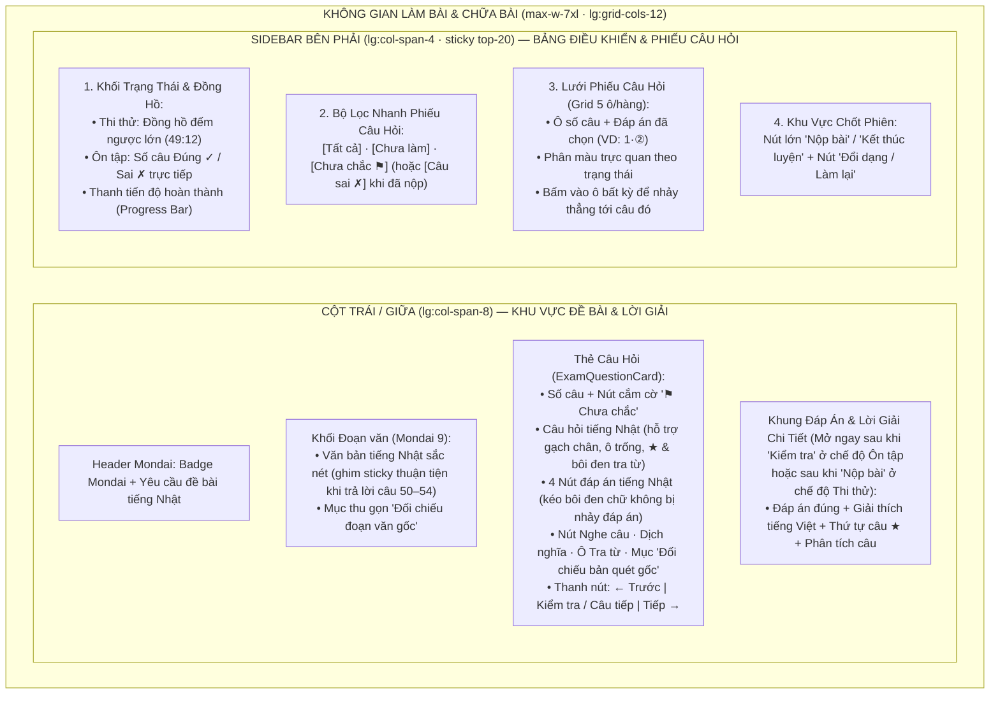

# Đặc tả Thiết kế Giao diện & Kiến trúc Mở rộng Phân hệ Luyện Đề (Exam UI/UX Master Specification)

- **Ngày lập**: 06/11/2026
- **Phiên bản**: 3.0 (Bản Đặc Tả Tổng Thể Hoàn Chỉnh — Đã rà soát toàn bộ lịch sử trao đổi & mã nguồn mới nhất)
- **Trạng thái**: Sẵn sàng triển khai code
- **Tài liệu liên quan**: [jlpt-practice-v1.md](./jlpt-practice-v1.md) · [jlpt-v1-testing.md](./jlpt-v1-testing.md) · [jlpt-v1-validation.md](./jlpt-v1-validation.md)

---

## 1. Tổng hợp Bối cảnh, Vấn đề Hiện tại & Đồng bộ Code Mới Nhất

### 1.1. Các vấn đề của giao diện và trải nghiệm hiện tại cần giải quyết
1. **Lệch chuẩn ngôn ngữ thiết kế (Design System)**:
   - Các trang chính của *Language Master* (`Của tôi`, `Khám phá`, `Từ điển`, `Luyện tập`) sử dụng hệ thống thẻ bo góc lớn (`rounded-2xl` / `rounded-3xl`), đổ bóng tinh tế (`shadow-sm` ➔ `hover:shadow-xl`), bảng màu Indigo – Violet – Emerald – Amber – Rose sống động, và bộ icon `lucide-react` trực quan.
   - Phân hệ `Luyện đề` hiện tại (`src/pages/Exam/*`) đang dùng CSS tối giản (`exam.css`), không có icon minh họa, chỉ dùng ký tự ASCII thô (`←`, `→`, `✓`, `✗`, `⚑`, `○`, `▾`) và các thẻ HTML mặc định (`
`, `<select>`).
2. **Lỗi tương phản ở Chế độ Tối (Dark Mode)**:
   - Lớp `.exam-card` và `.exam-option` đang dùng `dark:bg-slate-900` trùng với màu nền trang `dark:bg-slate-900`, làm toàn bộ thẻ bị chìm vào nền tối, mất chiều sâu thị giác (chuẩn của ứng dụng là nền trang `dark:bg-slate-900` và nền thẻ `dark:bg-slate-800`).
3. **Phòng làm bài 1 cột đơn điệu, thiếu Sidebar điều khiển bên phải như các phần mềm khảo thí chuyên nghiệp**:
   - Hiện tại phòng làm bài gom tất cả vào 1 cột hẹp (`max-w-4xl`), muốn xem Phiếu câu hỏi phải bấm nút mở/đóng thủ công khiến trải nghiệm thiếu trực quan so với các phần mềm thi tiêu chuẩn (nơi đề bài nằm bên trái/giữa và bảng câu hỏi + đồng hồ + nút nộp bài luôn hiển thị cố định bên phải).
4. **Mất icon tiện ích nổi `[:: ⏱ 25:00 | 文A]` (`FloatingStudyTimer`) và hạn chế tra từ khi vào `/exams`**:
   - Tại [`src/App.tsx`](../../src/App.tsx) (dòng 50–53), hàm `StudyTools()` đang chặn `pathname.startsWith("/exams") ? null : <FloatingStudyTimer />`, làm biến mất thanh tiện ích nổi khi vào Luyện đề.
   - Trong `ExamWorkspace.tsx` và `ExamQuestionCard.tsx`, tính năng tra từ đang bị khóa khi làm bài `mock`, và `WordLookupModal.tsx` chỉ tìm trong danh sách tĩnh nhỏ (`lookupWordInDictionary`) thay vì kết nối với bộ **Tra cứu Đa Sách (`lookupInSystemMultiBook`)** và **Tra cứu Trực tuyến Ngoài hệ thống (`lookupExternal`)**.
5. **Chưa có chế độ "Đề Chuẩn Ngẫu Nhiên Toàn Hệ Thống", chưa cho phép tích chọn nhiều Mondai và chưa tách bạch "Chấm Điểm Chuẩn" vs "Đếm Câu Đúng"**:
   - Hiện tại chỉ chọn được 1 Mondai đơn lẻ hoặc trộn ngẫu nhiên 10/20/50 câu, chưa có chế độ tạo **1 Đề Chuẩn 54 Câu Ngẫu Nhiên** theo đúng tỷ lệ đề thi thật (`5-5-5-7-5-5-12-5-5`), chưa hỗ trợ tích gộp nhiều Mondai theo ý thích, và chưa có cơ chế chấm điểm chuẩn JLPT (thang 60đ) tách biệt với thống kê câu đúng khi ôn tự do.

### 1.2. 5 Điểm đồng bộ với bộ dữ liệu 1,080 câu Text-first vừa cập nhật
1. **1,080 câu hỏi đã chuyển sang văn bản (`delivery: "text"`, `transcriptionStatus: "verified"`)**: Hiển thị trực tiếp câu hỏi (`q.stem`), 4 phương án (`q.options`), đoạn văn (`passage.text`) và chú thích (`passage.notes`) qua [`ExamText.tsx`](../../src/pages/Exam/components/ExamText.tsx) (hỗ trợ gạch chân `[từ]`, ô trống đoạn văn `[[50]]`, chỗ trống `____`, dấu sao `★` và furigana `{{漢字|かんじ}}`).
2. **Ảnh quét gốc nằm trong mục thu gọn (`
`)**: Giữ nguyên `
Đối chiếu bản quét gốc
` (ở câu hỏi) và `
Đối chiếu đoạn văn gốc
` (ở đoạn văn).
3. **Bảo toàn thuộc tính `data-exam-selectable` & chặn nhảy đáp án khi kéo chuột bôi đen**: Mỗi thẻ câu hỏi đơn giữ đúng **5 phần tử `[data-exam-selectable]`** (1 ở câu hỏi + 4 ở phương án), và giữ logic chặn `event.preventDefault()` khi `window.getSelection()?.isCollapsed === false`.
4. **Nút `Nghe câu` (TTS qua `examPlainText`)**: Hiện diện trên tất cả 1,080 câu hỏi.
5. **Bảo toàn 100% cho 143 bài kiểm thử tự động (55 test dữ liệu + 88 test giao diện)**.

---

## 2. Kiến trúc Mở Rộng Đa Ngôn Ngữ, Đa Kỹ Năng & 3 Trụ Cột Luyện Đề

### 2.1. Sơ đồ Kiến trúc Tổng thể

### 2.2. Xử lý Kỹ năng Đọc hiểu (`読解 Dokkai`) & Nghe hiểu (`聴解 Choukai`) trong JLPT (Hiện tại & Tương lai)
Một kỳ thi JLPT đầy đủ gồm **3 Phần (3 Kỹ năng lớn, mỗi phần 60 điểm = Tổng 180 điểm)**:
1. **Phần 1: Kiến thức ngôn ngữ — Chữ Hán · Từ vựng · Ngữ pháp (`文字・語彙・文法`)** *(Đang hoạt động — 1,080 câu · Mondai 1–9)*.
2. **Phần 2: Đọc hiểu (`読解 · Dokkai` — Đoạn văn ngắn, trung, dài, tìm kiếm thông tin · Mondai 10–13)** *(Hiện tại: Gắn nhãn `Đang phát triển`)*.
3. **Phần 3: Nghe hiểu (`聴解 · Choukai` — Nghe hiểu có tranh, không tranh, phản xạ nhanh)** *(Hiện tại: Gắn nhãn `Đang phát triển`)*.

- **Tại trang Kho đề JLPT (`/exams/jlpt`)**: Hiển thị dải **Tab Kỹ năng** (`✅ Tất cả` | `✅ Chữ Hán · Từ vựng · Ngữ pháp` | `⏳ Đọc hiểu · 読解 (Đang phát triển)` | `⏳ Nghe hiểu · 聴解 (Đang phát triển)`). Khi về sau thêm sách có `skills: ["reading"]` hoặc `skills: ["listening"]`, tab tương ứng tự động mở khóa.
- **Tại màn hình Thiết lập Luyện tập (`Setup`)**: Bên dưới 3 nhóm đang hoạt động (`漢字 Chữ Hán`, `語彙 Từ vựng`, `文法 Ngữ pháp`), hiển thị 2 thẻ Preview виền nét đứt cho **`📖 Đọc hiểu chuyên sâu · 読解 (Đang phát triển)`** và **`🎧 Nghe hiểu · 聴解 (Đang phát triển)`**.
- **Tại màn hình Kết quả Chấm điểm Chuẩn (`/result`)**: Hiển thị khung 3 cột điểm của JLPT:
  1. **Kiến thức ngôn ngữ (Chữ Hán · Từ vựng · Ngữ pháp)**: **`X / 60 điểm`** *(Chấm thực tế)*.
  2. **Đọc hiểu (`読解`)**: **`— / 60 điểm`** *(Đang phát triển)*.
  3. **Nghe hiểu (`聴解`)**: **`— / 60 điểm`** *(Đang phát triển)*.

---

## 3. Phân tích Chuyên sâu: 3 Cách Chia Số Câu & Quy Tắc Chấm Điểm (Chuẩn Đề vs Ôn Tự Do)

### 3.1. Thiết kế Màn hình Cấu hình Thống nhất: Mặc định chọn "Chuẩn Đề", tùy chỉnh linh hoạt theo 3 cách chia câu

### 3.2. Quy tắc Chấm Điểm: Khi nào chấm "Điểm Chuẩn Đề Thi" và khi nào chỉ tính "Số Câu Đúng"?

| Trường hợp cấu hình bài làm | Cơ chế Chấm Điểm & Hiển thị ở màn hình Kết quả (`/result`) |
|---|---|
| **Trường hợp 1: Đủ Form Chuẩn 1 Đề Thi (Đủ 9 Mondai · Đúng 54 câu chuẩn `5-5-5-7-5-5-12-5-5`)** *(Áp dụng cho cả **Đề cố định Day 1..20** và **Đề ngẫu nhiên chuẩn cấu trúc 54 câu**)* | **🏆 CHẤM ĐIỂM CHUẨN ĐỀ THI (Standard JLPT Exam Scoring)**: 1. **Điểm Quy Đổi Chuẩn (Thang `0 – 60 điểm` phần Văn tự · Từ vựng · Ngữ pháp)** tính theo trọng số từng Mondai, kèm đánh giá mốc điểm liệt (`>= 19/60`) và mốc đạt chuẩn (`>= 38/60`), bên cạnh 2 ô chờ Đọc hiểu & Nghe hiểu (`Đang phát triển`). 2. **Điểm theo 2 Phần Chuẩn**: Phần Chữ Hán & Từ vựng (`Đúng X/32 câu`) · Phần Ngữ pháp (`Đúng Y/22 câu`). 3. **Bảng chuẩn từng Mondai (`Mondai 1` ➔ `Mondai 9`)**: Đúng `A/5`, `B/7`, `C/12`... |
| **Trường hợp 2: Chọn Lẻ Một Số Mondai Nhưng Lấy Theo Định Mức Chuẩn (Cách 1)** *(VD: Chỉ tích Mondai 1 + Mondai 2 theo định mức chuẩn = `5 + 5 = 10 câu`)* | **📏 CHẤM THEO ĐỊNH MỨC MONDAI CHUẨN**: - Không quy ra thang 60 điểm toàn đề (vì chưa làm đủ 9 Mondai). - Hiển thị **Số câu đúng trên định mức chuẩn của từng Mondai đã chọn** (`Mondai 1: Đúng 4/5 chuẩn đề` · `Mondai 2: Đúng 5/5 chuẩn đề`) + Tổng số câu đúng (`9/10 câu · 90%`). |
| **Trường hợp 3: Ôn Tự Do Tùy Chỉnh Số Lượng Câu (Cách 2: Chia đều hoặc Cách 3: Mỗi dạng N câu)** *(VD: Chọn 20 câu bất kỳ, hoặc 50 câu M1 + 50 câu M2)* | **📊 CHỈ THỐNG KÊ SỐ CÂU ĐÚNG & TỶ LỆ % (Practice Accuracy Count)**: - **Không chấm điểm theo form đề thi**. - Chỉ hiển thị trung thực: **Số câu Đúng (`✓`)** · **Số câu Sai (`✗`)** · **Số câu Bỏ trống (`○`)** · **Tỷ lệ chính xác (`%`)**. - Thống kê số câu đúng của từng Mondai có mặt trong lượt ôn đó để người học bấm **`Luyện lại câu sai`**. |

---

## 4. Bố cục Phòng Thi 2 Cột Chuyên Nghiệp (Two-Column Exam & Review Layout)

Không gian làm bài và chữa bài (`ExamWorkspace.tsx`) trên màn hình máy tính (`lg:grid-cols-12`, độ rộng `max-w-7xl mx-auto`) được thiết kế theo chuẩn phần mềm khảo thí hiện đại:

### 4.1. Sự chuyển đổi thông minh giữa lúc "Đang Làm Bài" và lúc "Đã Nộp Bài / Xem Đáp Án"
1. **Khi Đang Làm Bài (`in_progress`)**:
   - **Chế độ Thi thử tính giờ (`mock`)**: Sidebar phải hiển thị Đồng hồ đếm ngược + Lưới 54 ô câu hỏi phân màu theo trạng thái **Đã khoanh (Màu Indigo + ký hiệu đáp án đã chọn)**, **Cắm cờ `⚑` (Màu vàng Amber)**, **Chưa khoanh (Màu xám)**.
   - **Chế độ Ôn tập từng câu (`drill`)**: Khi người dùng chọn đáp án câu nào và bấm `Kiểm tra`, hệ thống khóa kết quả lần đầu (First-Try Lock), mở ngay lời giải ở cột trái, và ô câu đó trên Sidebar phải đổi luôn sang màu **Xanh Emerald (`✓` Đúng)** hoặc **Đỏ Rose (`✗` Sai)** kèm bộ đếm trực tiếp `Đúng: X · Sai: Y`.
2. **Khi Đã Nộp Bài & Chữa Đề (`result` & Chế độ Xem lại sau khi nộp)**:
   - Sidebar phải biến thành **Bảng Điều Hướng Kết Quả Chấm Điểm**: Toàn bộ các ô câu hỏi được tô màu **Xanh lá (`✓` Đúng)**, **Đỏ (`✗` Sai)**, **Vàng/Xám (`Bỏ trống`)**, giúp người học bấm vào ô đỏ bất kỳ là nhảy thẳng tới câu đó để đọc lời giải.

---

## 5. Hệ thống Thiết kế Chuẩn hóa (Design System Tokens)

Toàn bộ giao diện `Luyện đề` tuân thủ nghiêm ngặt bảng quy chuẩn dưới đây để đồng bộ 100% với `Explore.tsx`, `MyCourses.tsx`, `Dictionary.tsx`, `CourseHub.tsx`, `VocabSetup.tsx`, `VocabQuiz.tsx`, và `VocabResult.tsx`:

| Thành phần | Quy chuẩn Tailwind CSS trong Language Master |
|---|---|
| **Khung trang (Page Wrapper)** | `min-h-[calc(100vh-3.5rem)] bg-slate-50 dark:bg-slate-900 p-4 md:p-8 pb-24 font-sans transition-colors duration-300` |
| **Độ rộng nội dung (Container)** | `max-w-6xl mx-auto space-y-6 md:space-y-8` (Trang danh sách/Hub) hoặc `max-w-7xl mx-auto space-y-6` (Không gian phòng thi 2 cột) |
| **Thẻ chính (`.exam-card`)** | `bg-white dark:bg-slate-800 rounded-3xl p-5 md:p-6 border border-slate-200 dark:border-slate-700 shadow-sm` *(Sửa triệt để lỗi `dark:bg-slate-900` bị chìm vào nền tối)* |
| **Thẻ tương tác (Interactive Card)** | `bg-white dark:bg-slate-800 rounded-2xl p-5 border-2 border-slate-200 dark:border-slate-700 hover:border-indigo-400 dark:hover:border-indigo-500 shadow-sm hover:shadow-xl hover:-translate-y-0.5 transition-all` |
| **Tiêu đề trang (H1)** | `text-2xl md:text-3xl font-black text-slate-800 dark:text-white tracking-tight flex items-center gap-3` |
| **Tiêu đề khối (H2)** | `text-lg md:text-xl font-black text-slate-800 dark:text-white` |
| **Nhãn phụ (`.exam-eyebrow`)** | `text-[11px] font-black uppercase tracking-wider px-2.5 py-1 rounded-lg bg-indigo-50 dark:bg-indigo-900/40 text-indigo-600 dark:text-indigo-400 inline-flex items-center gap-1.5` |
| **Nút chính (`.exam-primary`)** | `inline-flex items-center justify-center gap-2 rounded-xl px-5 py-3 min-h-11 bg-indigo-600 hover:bg-indigo-700 text-white font-bold text-sm shadow-md shadow-indigo-500/20 transition-all active:scale-[0.98] disabled:opacity-40` |
| **Nút phụ (`.exam-secondary`)** | `inline-flex items-center justify-center gap-1.5 rounded-xl px-4 py-2.5 min-h-11 border border-slate-200 dark:border-slate-600 bg-white dark:bg-slate-800 hover:bg-slate-50 dark:hover:bg-slate-700 text-slate-700 dark:text-slate-200 font-bold text-xs sm:text-sm hover:border-indigo-400 transition-all disabled:opacity-40` |

---

## 6. Đặc tả Khôi phục & Thiết kế Lại Tiện Ích Tra Từ (`FloatingStudyTimer`, `SelectionLookupPopover` & `WordLookupModal`)

### 6.1. Cho phép Tra từ hoạt động 100% ở mọi nơi (Không cấm chặn khi làm bài)
1. **Trong `src/App.tsx`**:
   - Bỏ điều kiện chặn `pathname.startsWith("/exams") ? null` để `<FloatingStudyTimer />` (viên thuốc nổi `[:: ⏱ 25:00 | 文A]`) luôn hiển thị trên mọi trang.
2. **Trong `src/pages/Exam/ExamWorkspace.tsx` và `src/pages/Exam/components/ExamQuestionCard.tsx`**:
   - Cho phép bôi đen tra từ (`SelectionLookup`), nút `Nghe câu`, `Dịch nghĩa`, ô nhập `Tra từ` và các nút tra cứu hoạt động tự do ở **mọi chế độ** (kể cả khi đang làm bài `mock`, `drill`, hay `review` — không khóa hay ẩn tính năng tra từ khi đang làm bài).

### 6.2. Thiết kế lại Popup `TIỆN ÍCH HỌC TẬP & TRA TỪ` (`src/components/shared/FloatingStudyTimer.tsx`)
1. **Header Modal Sang Trọng**:
   - Nền Gradient tinh tế, icon `<Sparkles />` trong khối bo góc Indigo–Violet có bóng đổ mềm.
2. **Cột Trái — Đồng Hồ Tập Trung (Loại bỏ khoảng trống thừa)**:
   - Xóa bỏ `justify-between` làm rỗng giữa thẻ; thêm **Thanh tiến độ (Progress Bar)** hiển thị % thời gian Pomodoro ngay trong khung đồng hồ `25:00`.
3. **Cột Phải — Trợ Lý Tra Từ Đa Sách**:
   - Làm nổi bật trạng thái **● ĐANG BẬT / ○ ĐÃ TẮT** của công tắc.
   - **Bổ sung Ô Nhập Tra Từ Trực Tiếp ngay trong Popup** (`[🔍 Nhập từ tiếng Nhật/Việt bất kỳ để tra ngay...] [Tra cứu]`).
   - Thiết kế lại 3 thẻ tính năng (*Gom Đa Sách*, *Dịch từ & câu dài*, *1-Chạm lưu Sổ tay*) sắc nét, hiện đại.

### 6.3. Nâng cấp toàn diện Popup Kết quả Tra từ (`src/pages/Exam/components/WordLookupModal.tsx`)
- Hiển thị từ đang tra lớn, nút **Nghe phát âm (`<Volume2 />`)**, kết quả **Nội bộ & Đa sách trong hệ thống (`lookupWordInDictionary` + `lookupInSystemMultiBook`)**, kết quả **Dịch trực tuyến ngoài hệ thống (`lookupExternal`)** và nút **`+ Lưu vào kho` (`quickSaveWordToNotebook`)**.

---

## 7. Đặc tả Chi tiết Từng Màn hình Phân Hệ Luyện Đề

### 7.1. Màn hình 1: Cổng 4 Ngôn Ngữ Luyện Đề (`src/pages/Exam/ExamLanguageHub.tsx` — `/exams`)
- **Header**: Badge `LUYỆN ĐỀ`, tiêu đề `Bạn muốn luyện ngôn ngữ nào?` kèm icon `<GraduationCap />`.
- **Grid 4 Ngôn ngữ (`grid-cols-1 md:grid-cols-2 gap-6`)**:
  1. **🇯🇵 Tiếng Nhật (`日本語 · JLPT N5 – N1`) — Đang hoạt động**:
     - Hiển thị rõ các mảng đã có (`Chữ Hán · Từ vựng · Ngữ pháp · 1,080 câu`) và các mảng đang cập nhật (`Đọc hiểu · Nghe hiểu — Đang phát triển`).
     - Nút chính: `Vào kho JLPT →`.
  2. **🇬🇧 Tiếng Anh (`English · TOEIC / IELTS`) — Badge `Đang phát triển`**.
  3. **🇨🇳 Tiếng Trung (`中文 · HSK 1 – 6`) — Badge `Đang phát triển`**.
  4. **🇰🇷 Tiếng Hàn (`한국어 · TOPIK I & II`) — Badge `Đang phát triển`**.

### 7.2. Màn hình 2: Trung Tâm Luyện Đề JLPT (`src/pages/Exam/JLPTExamHub.tsx` — `/exams/jlpt`)
1. **Banner Phiên đang làm trong tab (`attempt`)**: Spotlight Card kèm thanh tiến độ và nút `Làm tiếp` / `Xem kết quả` / `Xóa phiên`.
2. **Thanh Tìm kiếm, Lọc Cấp độ & Lọc Kỹ năng**:
   - Ô tìm kiếm (`aria-label="Tìm sách hoặc bài"`).
   - Dải Pill Cấp độ (`Tất cả`, `N1`..`N5`) đồng bộ với `<select>`.
   - Dải Pill Kỹ năng: `✅ Chữ Hán · Từ vựng · Ngữ pháp (Đã có)` | `⏳ Đọc hiểu · 読解 (Đang phát triển)` | `⏳ Nghe hiểu · 聴解 (Đang phát triển)`.
3. **Khu vực 1 (Phía trên) — Khối Ngân Hàng Đề Ngẫu Nhiên & Ôn Tự Do Toàn Hệ Thống**:
   - **Thẻ 1: `🏆 Thi Thử Đề Chuẩn Ngẫu Nhiên`** (*54 câu chuẩn 9 Mondai · 50 phút · Chấm điểm chuẩn JLPT*).
   - **Thẻ 2: `⚡ Ôn Tự Do & Luyện Theo Dạng`** (*Tự chọn Mondai & Số câu · Chữa từng câu ngay*).
4. **Khu vực 2 (Ngay bên dưới) — 📚 Kho Sách & Danh Sách Đề Theo Từng Bài/Ngày (`Book & Day Catalog`)**:
   - Header Đầu Sách (`
`), Banner `Luyện theo dạng · toàn bộ sách`, và **Lưới 20 Đề Theo Ngày (`Grid 2–3 cột`: `Day 1` ➔ `Day 20`)** kèm badge tiến độ từ `localStorage` (`✅ Đã làm · Cao nhất: X/54`) và các nút `Làm bài có giờ`, `Xem đề & lời giải`.

### 7.3. Màn hình 3: Chi Tiết Bài Thi & Thiết lập Lượt Luyện Tập (`ExamWorkspace.tsx`)
- **Bước 0 — Phạm vi Nguồn câu hỏi**: `Toàn bộ sách (20 bài · 1,080 câu)` hoặc `Chỉ riêng 1 bài/ngày cụ thể (Day 1..Day 20)`.
- **Bước 1 — Chọn Dạng Bài**:
  - Mặc định tích sẵn Tất cả 9 Mondai (`Chữ Hán`, `Từ vựng`, `Ngữ pháp`).
  - Hiển thị thêm 2 thẻ Preview trạng thái `Đang phát triển` cho **`📖 Đọc hiểu (読解 · Mondai 10–13)`** và **`🎧 Nghe hiểu (聴解 · Choukai)`**.
- **Bước 2 — Chọn Cách Phân Bổ & Số Câu**:
  1. `🎯 Theo chuẩn đề thi (Mặc định)`
  2. `📊 Tổng số câu cả lượt (10 / 20 / 50 / Tất cả) — Chia đều`
  3. `🔢 Số câu mỗi dạng (5 / 10 / 20 / 50 câu × mỗi dạng)`
- **Hộp Xem Trước Cấu Trúc & Chế Độ Chấm Điểm**: Hiển thị rõ tổng số câu, số câu từng Mondai và chế độ chấm điểm trước khi bấm `Bắt đầu luyện`.

### 7.4. Màn hình 4: Phòng Làm Bài 2 Cột, Chia Đôi Bài Đọc & Phím Tắt (`ExamWorkspace.tsx` & `ExamQuestionCard.tsx`)
- **Bố cục 2 Cột (`lg:grid-cols-12`)**: Cột Trái/Giữa (`lg:col-span-8`) làm đề & xem lời giải; Sidebar Phải (`lg:col-span-4`, `lg:sticky lg:top-20`) hiển thị Đồng hồ, Tiến độ, Bộ lọc Phiếu câu hỏi (`Tất cả`, `Chưa chọn`, `Chưa chắc ⚑`), Lưới ô câu hỏi phân màu và Nút `Nộp bài` / `Kết thúc luyện`.
- **Khối Đoạn văn (`Mondai 9`)**: Ghim thuận tiện trên màn hình lớn để vừa đọc đoạn văn vừa trả lời câu 50–54 mà không bị cuộn mất đoạn văn.
- **Thẻ Câu Hỏi & Khung Chữa Bài 3 Tầng (`ExamQuestionCard.tsx`, `SentenceBreakdownPanel.tsx`, `sentenceAnalyzer.ts`)**:
  - Bố cục 4 phương án tự động xếp 2 cột (`sm:grid-cols-2`) với đáp án ngắn và 1 cột (`grid-cols-1`) với đáp án câu dài.
  - Bỏ thanh `<input>` tra từ lặp lại ở từng câu hỏi; thay bằng hàng công cụ gọn gàng (`Nghe câu`, `Tra & Dịch câu`, `Xem đáp án & lời giải` / `Thu gọn lời giải`, `Đối chiếu bản quét gốc`).
  - Tự động bung sẵn lời giải ngay khi bấm `Kiểm tra` ở chế độ Ôn tự do (`drill`) hoặc khi bấm `Xem lại bài` / `Xem câu sai` ở màn hình Kết quả (`result`).
  - **Khung Chữa Bài 3 Tầng**:
    1. **Tầng 1 (Kết luận & Dịch câu)**: Hiển thị `Đáp án: X` kèm nhãn nội dung phương án đúng, đối chiếu phương án người dùng chọn sai (nếu có), và hiển thị hộp **Dịch câu** hoàn chỉnh (dùng `translationVi` có sẵn hoặc tự động dịch câu hoàn chỉnh đã ghép đáp án).
    2. **Tầng 2 (Giải thích trọng tâm & Ghép câu dấu ★)**: Hiển thị lời giải chi tiết, ghi chú các phương án và hộp ghép câu hoàn chỉnh cho dạng bài dấu sao `★` (Mondai 8).
    3. **Tầng 3 (Từ vựng & Cấu trúc trong câu — Zero Empty Cards)**: Kết hợp trích xuất trực tiếp từ vựng/cách đọc/nghĩa từ lời giải (`extractPartsFromExplanation`) với bộ phân tích từ điển nội bộ có khử chia thể (`getCandidateBaseForms`) và tra âm Hán Việt (`lookupKanjiHanViet`). Tuyệt đối loại bỏ hư từ, khử trùng lặp 100% và không bao giờ hiển thị ô từ vựng rỗng không có nghĩa.
- **Phím tắt bàn phím**: `1`–`4` (chọn đáp án), `Enter`/`Space` (kiểm tra), `←`/`→` (chuyển câu), `F` (đánh dấu cờ), tự động tắt khi đang gõ trong input `Tra từ`.

### 7.5. Màn hình 5: Bảng Kết Quả, Phân Tích Điểm & Lịch Sử Tiến Độ (`Result` & `Review`)
- Hiển thị **Bảng Điểm Chuẩn JLPT (Thang 60đ phần Kiến thức ngôn ngữ + 2 ô chờ Đọc hiểu/Nghe hiểu `Đang phát triển`)** khi làm đúng form chuẩn 54 câu; hoặc chỉ thống kê **Số câu Đúng/Sai/Bỏ trống/Tỷ lệ %** khi ôn tự do.
- **Bảng Phân tích theo từng Mondai** kèm thanh tiến độ.
- **Dải Chip lọc Mondai 1 chạm** ở chế độ `Xem đề & lời giải (Review)`.

---

## 8. Ràng buộc Kỹ thuật & Bảo toàn 143 Bài Kiểm thử Tự động (55 Data Tests + 88 UI Tests)

1. **Giữ nguyên 100% cấu trúc Route & URL**:
   - `/exams`, `/exams/jlpt`, `/exams/jlpt/:examId`, `/exams/jlpt/:examId/drill`, `/exams/jlpt/:examId/mock`, `/exams/jlpt/:examId/review`, `/exams/jlpt/:examId/result`.
2. **Giữ nguyên các thuộc tính phục vụ Bôi đen Tra từ (`SelectionLookup`)**:
   - Giữ thuộc tính `data-exam-selectable` trên:
     1. Văn bản đoạn văn (`passage.text`)
     2. Chú thích đoạn văn (`passage.notes`)
     3. Câu hỏi (`q.stem`)
     4. Văn bản của 4 phương án (`q.options`) — đảm bảo mỗi thẻ câu hỏi có đúng **5 phần tử `[data-exam-selectable]`**.
   - Giữ sự kiện `onClick` chặn `event.preventDefault()` khi `window.getSelection()?.isCollapsed === false` trên thẻ `<label>` của phương án.
   - Giữ nguyên nút nổi `Tra từ đã chọn` trong `SelectionLookup.tsx`.
3. **Giữ nguyên các Accessible Roles, Labels & Text dùng trong bộ kiểm thử DOM**:
   - Các nhãn điều khiển: `Chọn dạng`, `Số câu mỗi lượt`, `Tìm sách hoặc bài`, `Phiếu câu hỏi`, `Từ tiếng Nhật cần tra`.
   - Các mục thu gọn bản quét gốc: `Đối chiếu bản quét gốc`, `Đối chiếu đoạn văn gốc`.
   - Các nút hành động: `Bắt đầu luyện`, `Bắt đầu làm bài`, `Đổi dạng / số câu`, `Làm tiếp`, `Kết thúc và xóa phiên`, `Nộp bài`, `Kết thúc luyện`, `Kiểm tra`, `Kiểm tra nhóm`, `Xem lại bài`, `Xem câu sai`, `Luyện câu sai`, `Luyện câu bỏ trống`, `Luyện câu chưa chắc`, `Mở tất cả lời giải`, `Thu gọn lời giải`, `Thu gọn tất cả`, `Xem đáp án & lời giải`, `Phóng to để đọc rõ`, `Thu nhỏ bản gốc`, `Quay lại`, `Xác nhận`, `Tra từ`, `Tra từ đã chọn`, `Nghe câu`, `Dịch nghĩa`, `Đóng`.
   - Các input radio của phương án: `aria-label="Phương án ${i + 1}, câu ${q.number}"`.
   - Câu trả lời trong lời giải: `Đáp án: ${q.answer}`.
   - Các role: `role="dialog"`, `role="status"`, `role="group"`.
